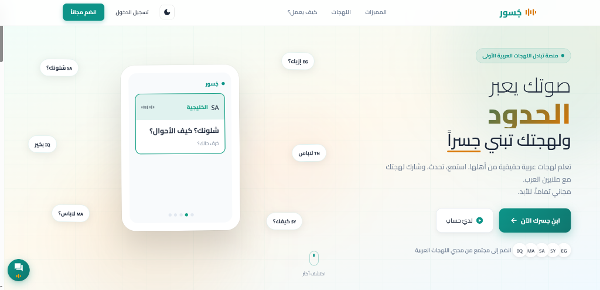
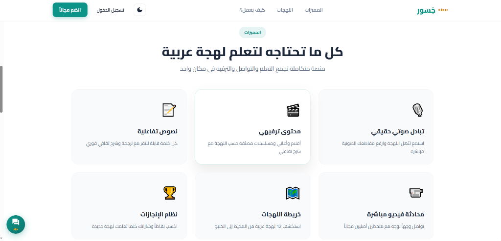
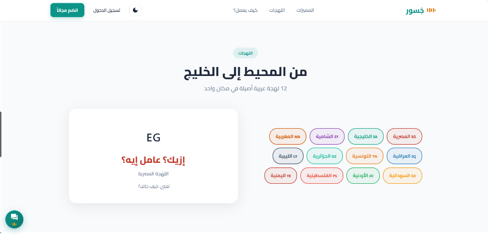
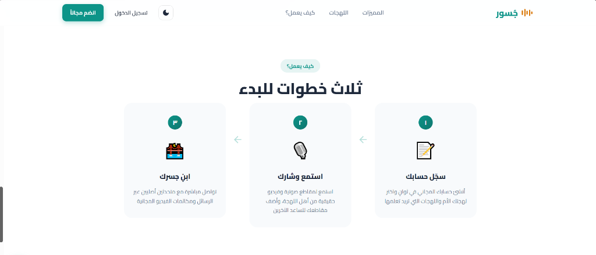
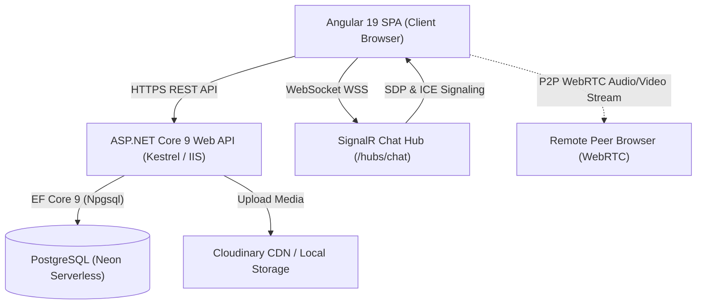

<div align="center">

# 🌉 جُسور | Josour
### The Pan-Arab Dialects & Cultural Exchange Platform
**منصة التبادل الثقافي واللهجات العربية الأولى**

[](https://dotnet.microsoft.com/)
[](https://angular.dev/)
[](https://neon.tech/)
[](https://dotnet.microsoft.com/apps/aspnet/signalr)
[](https://webrtc.org/)
[](https://www.typescriptlang.org/)

<br />



<br />
<br />

<p align="center">
  <b>صوتك يعبر الحدود ولهجتك تبني جسراً</b><br />
  A modern, high-performance web platform connecting Arabic speakers and language enthusiasts worldwide to explore, practice, and celebrate authentic Arabic dialects through multimedia bridges, real-time messaging, and peer-to-peer video/audio communication.
</p>

</div>

---

## 📋 Table of Contents
1. [About Josour](#-about-josour)
2. [Key Capabilities & Features](#-key-capabilities--features)
3. [Visual Tour & Screenshots](#-visual-tour--screenshots)
4. [Technology Stack](#-technology-stack)
5. [System Architecture](#-system-architecture)
6. [Repository Structure](#-repository-structure)
7. [Getting Started & Local Setup](#-getting-started--local-setup)
   - [Prerequisites](#prerequisites)
   - [Backend Configuration](#backend-setup-aspnet-core)
   - [Frontend Configuration](#frontend-setup-angular)
   - [Database Migrations](#database-setup-postgresql--ef-core)
8. [API & SignalR Hub Overview](#-api--signalr-hub-overview)
9. [DevSecOps & Security Hardening](#-devsecops--security-hardening)
10. [Authors & Acknowledgments](#-authors--acknowledgments)

---

## 📖 About Josour

Across the Arab world, from the Atlantic Ocean to the Arabian Gulf, Arabic is spoken in dozens of rich, vibrant dialects—each with its own unique idioms, pronunciation, and cultural heritage. However, learners and cross-regional speakers often struggle to find authentic, interactive environments where they can hear everyday spoken dialects directly from native speakers.

**Josour (جُسور)** bridges this gap. Built from the ground up as a cloud-native, real-time social platform, Josour provides:
- **Authentic Exposure**: Everyday expressions, phrases, and vocabulary categorized across 12 distinct Arab regions.
- **Interactive Bridges**: Short multimedia clips (audio and video) contributed by native speakers with real-time community engagement.
- **Live Peer Connection**: High-fidelity WebRTC audio and video calls, combined with WebSocket-powered instant messaging.

---

## ✨ Key Capabilities & Features

### 🎙️ Dialect Bridges & Multimedia Sharing
- **Short Clip Publishing**: Users upload short video and audio clips illustrating expressions, jokes, accents, or cultural nuances.
- **Automatic Multi-Tier Storage**: Integrated Cloudinary cloud media storage with an automatic fallback to local disk storage (`wwwroot/uploads`) to guarantee zero upload disruption.
- **Interactive Video Player**: Embedded custom playback dialog with like, comment, and bookmark capabilities.

### 💬 Real-Time Messaging & Presence (SignalR)
- **Instant Chat**: One-to-one messaging powered by ASP.NET Core SignalR hubs with automated reconnect and message deduplication.
- **Rich Media Messages**: Send images, videos, documents, and voice recordings directly within the chat window.
- **Voice Message Recorder**: In-browser WebRTC MediaRecorder with studio waveform visualization and acoustic noise suppression.
- **Message Lifecycle**: Edit and soft-delete messages within a 5-minute safety window.
- **Live Presence & Typing**: Real-time online/offline indicators and read receipts.

### 📞 WebRTC Peer-to-Peer Calling
- **Direct Video & Audio Calls**: Low-latency, peer-to-peer audio and video calls connecting users across browsers.
- **Hardware Noise Suppression**: Integrated WebRTC acoustic echo cancellation (`echoCancellation: true`), noise suppression (`noiseSuppression: true`), and auto-gain control (`autoGainControl: true`) to deliver crystal-clear voice clarity.
- **Dynamic Call Signaling**: SignalR-powered exchange of ICE candidates and SDP offers/answers with call failure and rejection notifications.

### 🗺️ Pan-Arab Dialect Explorer
- **12 Supported Regional Dialects**: Egyptian (المصرية), Gulf (الخليجية), Levantine (الشامية), Moroccan (المغربية), Algerian (الجزائرية), Tunisian (التونسية), Iraqi (العراقية), Libyan (الليبية), Yemeni (اليمنية), Palestinian (الفلسطينية), Jordanian (الأردنية), and Sudanese (السودانية).
- **Interactive Flashcards**: Quick phrases, translations, and audio pronunciations for everyday conversational fluency.

### 📱 Responsive & Accessible UI
- **Mobile-First Experience**: Fully adaptive layout designed for desktop, tablet, and mobile devices with iOS/Android safe-area handling.
- **RTL-Native Design**: Tailored right-to-left Arabic typography using the Google Font *Cairo*, subtle glassmorphism, and accessible color tokens.

---

## 📸 Visual Tour & Screenshots

<div align="center">

### 1. Landing & Dialect Showcase

<p align="center"><i>Interactive hero section featuring floating dialect cards and audio waveforms.</i></p>

### 2. Comprehensive Platform Features

<p align="center"><i>Core modules: Audio exchange, multimedia entertainment, interactive transcripts, and video calls.</i></p>

### 3. Pan-Arab Dialect Explorer

<p align="center"><i>Explore 12 authentic regional dialects with instant vocabulary explanations and phrase previews.</i></p>

### 4. Seamless Onboarding Process

<p align="center"><i>Three simple steps: Create an account, explore and share clips, and connect with native speakers.</i></p>

</div>

---

## 🛠️ Technology Stack

| Layer | Technologies & Frameworks | Purpose & Highlights |
| :--- | :--- | :--- |
| **Frontend SPA** | **Angular 19+**, TypeScript, RxJS, Signals | Zoneless change detection, Standalone Components, Material UI, SCSS |
| **Backend API** | **ASP.NET Core 9 (C# .NET 9)**, Web API | Clean Layered Architecture, Kestrel, ASP.NET Identity |
| **Real-Time** | **Microsoft SignalR**, WebSockets | Bidirectional chat, live user status, call signaling |
| **P2P Streaming** | **WebRTC (RTCPeerConnection)** | Audio/video calls, noise cancellation, STUN/TURN traversal |
| **Database** | **PostgreSQL** on **Neon Lakebase Serverless** | Entity Framework Core 9 (Npgsql), connection pooling, migrations |
| **Object Storage** | **Cloudinary API** + Local Disk Fallback | Video clips, voice notes, profile avatars, and thumbnails |
| **Security** | **JWT Bearer**, BCrypt/Identity, Rate Limiting | Stateless authorization, claims-based security, sliding refresh |

---

## 🏗️ System Architecture



---

## 📁 Repository Structure

```text
josour-dialect-exchange/
├── dialect-exchange-frontend/           # Angular 19 SPA Frontend
│   ├── src/
│   │   ├── app/
│   │   │   ├── core/                   # Guards, Interceptors, State Services (Auth, Chat, Dialect)
│   │   │   └── features/               # Components: Landing, Home, Messages, VideoCall, Profile, etc.
│   │   ├── environments/               # Environment configuration files
│   │   └── index.html                  # HTML5 Entry, SEO, Open Graph & Favicons
│   ├── angular.json                    # Angular Workspace Build Definitions
│   └── package.json                    # Node dependencies & npm scripts
│
├── DialectExchange.API/                 # ASP.NET Core 9 Web API Entry Point
│   ├── Controllers/                    # REST API Endpoints (Auth, Exchanges, Messages, Users, Calls)
│   ├── Hubs/                           # SignalR Hubs (ChatHub for messaging & WebRTC signaling)
│   ├── Program.cs                      # Dependency Injection, Middleware, Rate Limiting, Kestrel
│   ├── appsettings.json                # Base configuration template (sanitized)
│   └── appsettings.Example.json        # Documented configuration template
│
├── DialectExchange.Core/                # Domain Entities, Interfaces & DTOs
│   ├── Entities/                       # ApplicationUser, Exchange, Dialect, Message, Comment
│   └── Interfaces/                     # ICloudinaryService, IEmailService, IAuthService
│
├── DialectExchange.Infrastructure/      # Data Access & External Integrations
│   ├── Data/                           # EF Core AppDbContext, Model Configurations & Seeders
│   ├── Migrations/                     # Entity Framework Core Schema Migrations
│   └── Services/                       # CloudinaryService (with Local Fallback), EmailService
│
├── docs/                               # Project Documentation & Screenshots
│   └── screenshots/                    # High-resolution application screenshots
│
├── .env.example                        # Safe environment variable template
├── .gitignore                          # Comprehensive DevSecOps ignore rules
├── DialectExchange.sln                 # Visual Studio Solution File
└── README.md                           # Main Project Documentation
```

---

## 🚀 Getting Started & Local Setup

### Prerequisites
Before running the project locally, ensure you have the following installed:
- **.NET 9.0 SDK**: [Download .NET 9](https://dotnet.microsoft.com/download/dotnet/9.0)
- **Node.js (LTS v20+)** & **npm**: [Download Node.js](https://nodejs.org/)
- **PostgreSQL**: A local PostgreSQL instance (v14+) or a free [Neon Serverless Postgres](https://neon.tech/) database.

---

### Backend Setup (ASP.NET Core)

1. **Clone the repository:**
   ```bash
   git clone https://github.com/Fetoooo/josour-dialect-exchange.git
   cd josour-dialect-exchange
   ```

2. **Configure your development settings:**
   Copy `appsettings.Example.json` to `DialectExchange.API/appsettings.Development.local.json`:
   ```bash
   cp DialectExchange.API/appsettings.Example.json DialectExchange.API/appsettings.Development.local.json
   ```
   *Note: Files ending in `.local.json` are strictly ignored by `.gitignore` to prevent committing private credentials.*

3. **Populate your configuration values in `appsettings.Development.local.json`:**
   ```json
   {
     "ConnectionStrings": {
       "DefaultConnection": "Host=localhost;Port=5432;Database=josour_db;Username=postgres;Password=your_password;"
     },
     "Jwt": {
       "Key": "YOUR_STRONG_SECRET_KEY_WITH_AT_LEAST_64_CHARACTERS_FOR_SECURITY_PURPOSES"
     }
   }
   ```

4. **Apply database migrations:**
   ```bash
   dotnet ef database update --project DialectExchange.Infrastructure --startup-project DialectExchange.API
   ```

5. **Run the API server:**
   ```bash
   dotnet run --project DialectExchange.API
   ```
   The API will launch at `http://localhost:5277` (Swagger available at `http://localhost:5277/swagger`).

---

### Frontend Setup (Angular)

1. **Navigate to the frontend directory:**
   ```bash
   cd dialect-exchange-frontend
   ```

2. **Install dependencies:**
   ```bash
   npm install
   ```

3. **Start the development server:**
   ```bash
   npm start
   ```
   Navigate to `http://localhost:4200` in your browser. The app will automatically reload if you change any of the source files.

---

## 🔌 API & SignalR Hub Overview

### Core REST Endpoints

| Category | Method & Route | Description |
| :--- | :--- | :--- |
| **Auth** | `POST /api/auth/register` | Register a new user account with dialect selection |
| **Auth** | `POST /api/auth/login` | Authenticate user and issue JWT bearer token |
| **Auth** | `GET /api/auth/verify-email` | Verify user email address from activation link |
| **Auth** | `POST /api/auth/forgot-password` | Request password reset token via email |
| **Auth** | `POST /api/auth/reset-password` | Set new password with verified security token |
| **Bridges** | `GET /api/exchanges` | List dialect clips with dialect & keyword filters |
| **Bridges** | `POST /api/exchanges/upload` | Upload new video/audio clip with thumbnail |
| **Bridges** | `POST /api/exchanges/{id}/comments` | Add comment to a specific dialect bridge |
| **Bridges** | `POST /api/exchanges/{id}/like` | Toggle like status on a bridge |
| **Chat** | `GET /api/messages/history/{id}` | Fetch conversation history with a user |
| **Chat** | `GET /api/messages/conversations` | Fetch active conversations list with unread counts |
| **Chat** | `POST /api/messages/upload` | Upload image, video, voice note, or document |
| **Dialects** | `GET /api/dialects` | Retrieve all supported Arab dialects and metadata |

### Real-Time SignalR Hub (`/hubs/chat`)

- **`SendMessage(receiverId, content)`**: Delivers instant text message to recipient.
- **`SendFileMessage(receiverId, fileUrl, fileName, fileSize, type)`**: Delivers media attachment.
- **`CallUser(targetUserId, callerName, callType)`**: Initiates P2P video/audio call request.
- **`AcceptCall(callerId)`** / **`RejectCall(callerId)`** / **`EndCall(userId)`**: Call lifecycle handling.
- **`SendOffer(targetUserId, sdp)`** / **`SendAnswer(...)`** / **`SendIceCandidate(...)`**: WebRTC signaling.

---

## 🔒 DevSecOps & Security Hardening

- **Zero Credential Exposure**: Real connection strings, JWT signing keys, and API secrets are kept strictly out of Git using multi-stage `.gitignore` rules and local overrides.
- **File Validation Engine**: Uploaded media is validated for genuine file headers (magic bytes), MIME types, and maximum size limits before processing.
- **Rate Limiting**: Integrated ASP.NET Core FixedWindow rate limiting policies on authentication and upload endpoints to defend against brute force and denial of service.
- **CORS & Forwarded Headers**: Strict allowed origins and secure reverse-proxy forwarded headers configuration for production hosting.

---

## 📄 License

This project is published for portfolio and software architecture demonstration purposes. All rights reserved by the repository owner.
For inquiries regarding reuse, licensing, or commercial distribution, please contact the author.
